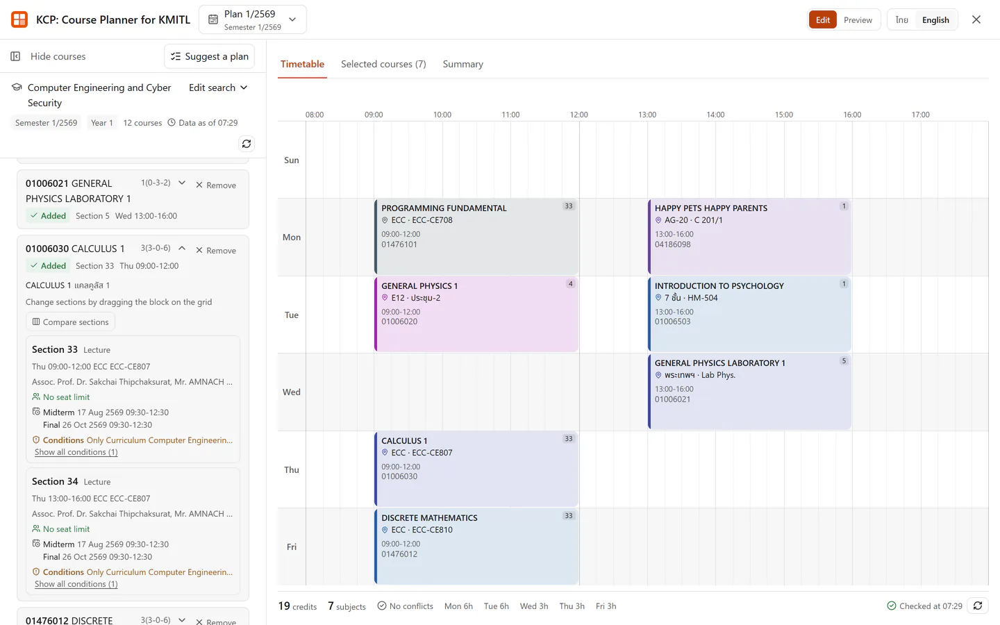

# KCP: Course Planner for KMITL

KCP is a browser extension that turns the KMITL registration course search into a weekly
timetable you can plan on before registration. Website: [kcp.cecs.sh](https://kcp.cecs.sh/).

KCP คือส่วนขยายเบราว์เซอร์สำหรับจัดตารางเรียน สจล. (KMITL) ที่แปลงผลการค้นหารายวิชาบนเว็บไซต์ลงทะเบียน
ให้เป็นตารางเรียนรายสัปดาห์ เพื่อช่วยวางแผนก่อนลงทะเบียนเรียน



- [Chrome Web Store](https://chromewebstore.google.com/detail/bkjijmajieoojchaknjdpbkaomnofnef)
  for Chrome, Edge, Brave, Opera, and other Chromium browsers
- [Firefox Add-ons](https://addons.mozilla.org/firefox/addon/course-planner-for-kmitl/)
  for Firefox
- [Project site](https://kcp.cecs.sh/) in Thai, and in [English](https://kcp.cecs.sh/en/)

KCP works in desktop browsers. Mobile browsers are not supported.

## What it does

- Searches course offerings the same three ways as the registration site: by curriculum
  and class year, by subject code, and by subject category.
- Merges the rows the site repeats across curriculum groupings, so each section appears
  once.
- Places sections on a weekly timetable by drag and drop or with an add button, and blocks
  class time and exam clashes before they reach the plan.
- Suggests up to three clash free timetables from a curriculum search.
- Keeps several named plans per term on your device, and checks them against the current
  course data each time you open them.
- Shows a plan as a timetable, as a list of selected courses, or as a summary with the exam
  schedule and the weekly workload.
- Exports a plan as an image sized for sharing, a phone or tablet wallpaper, or A4 print,
  or copies it as plain text.

KCP only reads public course data. It never signs in, never submits forms, and never
registers for courses; registration still happens on the registration site.

KCP: Course Planner for KMITL is an independent tool built by a student. It is not
affiliated with, sponsored by, or endorsed by King Mongkut's Institute of Technology
Ladkrabang (KMITL).

## Install

Install KCP from the
[Chrome Web Store](https://chromewebstore.google.com/detail/bkjijmajieoojchaknjdpbkaomnofnef)
or [Firefox Add-ons](https://addons.mozilla.org/firefox/addon/course-planner-for-kmitl/).
Each store reviews a new version on its own schedule, so an update can reach one store
before the other. Release notes are in [CHANGELOG.md](CHANGELOG.md) and on the
[releases page](https://github.com/txasw/kmitl-course-planner/releases).

## How to use

1. Open the course search page at https://regis.reg.kmitl.ac.th/#/teach_table_selector.
2. Open the planner with the Planner button at the bottom right of the page, the KCP icon
   in the browser toolbar, or Alt+Shift+P (Option+Shift+P on macOS). On any other tab, the
   icon and the shortcut open the registration search page with the planner.
3. Choose the term, run a search, and add sections to the timetable.
4. Switch to Preview to export the plan as an image or copy it as text.

The shortcut can be changed in the browser's extension shortcut settings. If another
extension already uses Alt+Shift+P, the browser may leave it unassigned; assign a different
key there.

## Privacy

Your plans, preferences, and searches are stored only in your browser. The extension has
no account, no server of its own, and no analytics or telemetry. Its only network requests
are read only GET requests to the public KMITL course services that the registration site
itself uses. The project site sets no cookies and runs no analytics. See
[docs/PRIVACY.md](docs/PRIVACY.md) for the full policy and the reason for each permission.

## Development

Requirements: Node 24, pinned in `.nvmrc` (the `engines` floor is 22.22.1, but the build,
the tests, and the release run on Node 24), and pnpm 10.12.1, pinned in the
`packageManager` field. Run `corepack enable` so the pinned pnpm runs rather than a
separately installed one.

### Getting started

```
pnpm install
pnpm dev            # Chrome and Chromium browsers
pnpm dev:firefox    # Firefox
```

`pnpm dev` builds the extension with hot reload and launches a separate browser profile
with it already loaded. The development build is the debug flavor: its name carries the
(Debug) suffix and the panel includes the diagnostics drawer. Each fresh development
profile shows the install welcome. To load the development build into an existing browser
profile instead, use Load unpacked on `.output/chrome-mv3-dev` (or `.output/firefox-mv3-dev`
for Firefox).

### Unpacked install for development or testing

To try a release build or a local build without the store, use the zips from the
[releases page](https://github.com/txasw/kmitl-course-planner/releases), or build them as
described in Building from source:

- Chromium browsers: open the extensions page, enable developer mode, and use Load
  unpacked on the unzipped Chrome build.
- Firefox: open `about:debugging`, choose This Firefox, and use Load Temporary Add-on on
  the unzipped build's `manifest.json`. A temporary add-on is removed when Firefox
  restarts.

### Building from source

These steps reproduce the release build, including the Firefox zip that the Add-ons review
rebuilds from the source package. They assume a clean checkout and the toolchain above.

```
corepack enable
pnpm install --frozen-lockfile
pnpm zip:firefox      # writes the firefox zip and the sources zip to .output
pnpm zip:chrome       # writes the chrome zip to .output
```

`pnpm zip:firefox` produces `.output/kmitl-course-planner-<version>-firefox.zip` and
`.output/kmitl-course-planner-<version>-sources.zip`. The shipped icons are committed PNGs,
so the build does not run the icon rasterizer; regenerate them only after editing
`assets/icon.svg`, with `pnpm icons`.

On Windows, if `pnpm install` fails with `ERR_PACKAGE_IMPORT_NOT_DEFINED` for a
`#module-sync-enabled` specifier, it is a known interaction between pnpm's symlinked
`node_modules` and the Node module resolver on Windows. Add a `.npmrc` with
`node-linker=hoisted` and install again. Linux, the continuous integration build, and the
Firefox Add-ons review are unaffected.

### Common tasks

```
pnpm typecheck      # TypeScript, no emit
pnpm lint           # ESLint
pnpm lint:fix       # ESLint with fixes
pnpm format:check   # Prettier, check
pnpm format         # Prettier, write
pnpm test           # unit and component tests
pnpm test:watch     # unit tests in watch mode
pnpm build          # production build for Chrome
pnpm build -b firefox
pnpm build:debug    # debug flavor build for Chrome
pnpm zip:chrome     # package the Chrome build
pnpm zip:firefox    # package the Firefox build and the AMO sources zip
pnpm icons          # regenerate the icon PNGs from assets/icon.svg
pnpm changeset      # record a user visible change
pnpm site:shots     # capture the landing screenshots from a debug build
pnpm site:encode    # encode the screenshots to AVIF and WebP
pnpm site:build     # render the landing site into site/
```

The end to end suite loads the built extension, so build both flavors and install the
Playwright Chromium first:

```
pnpm exec playwright install chromium
pnpm build
pnpm build:debug
pnpm test:e2e       # Playwright projects: smoke, debug, production, phone, tablet
```

The smoke project checks the production manifest, the production project runs against
`.output/chrome-mv3`, and the debug, phone, and tablet projects run against
`.output/chrome-mv3-debug`.

### Project layout

- `src/entrypoints` background service worker and the content script UI
- `src/features` interface features (shell, search, catalog, planner, plans, onboarding,
  and the debug only diagnostics drawer)
- `src/components` shared presentational components
- `src/lib` framework free domain logic, validation, storage, and utilities
- `tests/e2e` end to end specs and their mock host and API server
- `tests/fixtures` captured API responses and regression payloads
- `tests/scripts` unit tests for the repository scripts and the manifest
- `tests/site` checks for the landing site
- `tests/support` and `tests/setup.ts` shared test helpers and setup
- `site` the landing site served at https://kcp.cecs.sh/, the committed output of
  `pnpm site:build`, deployed as `wrangler.jsonc` describes (ADR-0066 and CONTRIBUTING.md)
- `scripts` the commit message guard, the icon generator, and the landing site generator
  in `scripts/landing`
- `assets` the source icon
- `public` static files copied into the extension, such as the icon set
- `docs/adr` architecture decision records

## Contributing

Issues and pull requests are welcome. Read [CONTRIBUTING.md](CONTRIBUTING.md) for the
branch model, the commit rules, and the local checks. A change that users will notice
needs a changeset (`pnpm changeset`), which feeds the changelog and the release notes.
Report bugs at https://github.com/txasw/kmitl-course-planner/issues.

## License

MIT. See [LICENSE](LICENSE).
